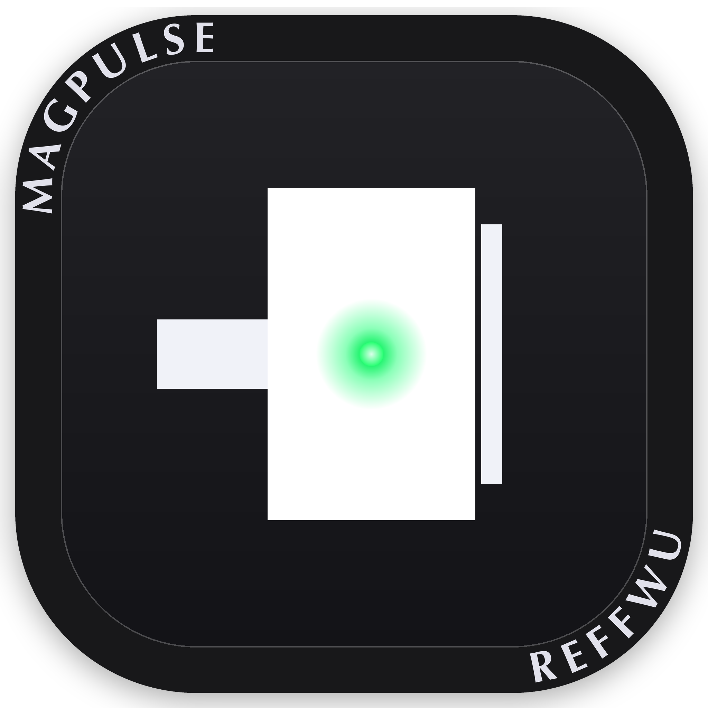
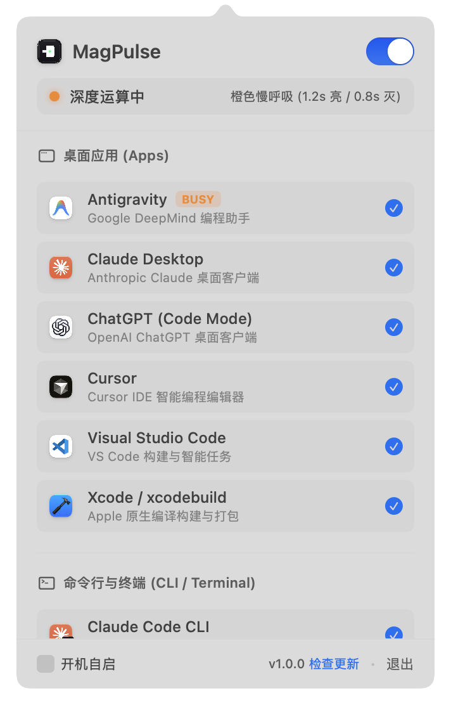

<div align="center">



# MagPulse

**MagSafe 硬件呼吸灯，全 Mac 的 AI Agent 律动触手可及。**

[English](README.md) · 简体中文

[](#系统要求)
[](#系统要求)
[](https://github.com/ReffWu/magpulse/releases/latest)
[](LICENSE)

</div>

---

MagPulse 将全 Mac 上所有 AI 助手、代码生成工具与编译器的思考、等待与完成状态，直接映射到 MacBook 机身左侧 **MagSafe 3 物理磁吸接口** 的双色双指示灯上。

无需频繁切屏查看：
- 🟠 **橙色呼吸**：模型正在思考推理、生成代码或执行自动化任务。
- 🟢 **翠绿常亮**：当前轮次或编译已顺利完成。用户切回查看后优雅淡出回归系统原生充电状态。
- 🟡 **黄绿跳动**：等待人工授权确认或终端输入。

<p align="center">
  
</p>

## 监控覆盖矩阵

### 桌面客户端
- **Antigravity**：Google DeepMind 编程助手（毫秒级活动感知与轮次检测）
- **Claude Desktop**：Anthropic Claude 官方桌面端
- **ChatGPT Desktop**：OpenAI 官方客户端
- **Cursor**：AI 代码编辑器
- **VSCode**：Visual Studio Code
- **Xcode**：Apple 官方开发套件与构建工具链

### 命令行与终端
- **Claude Code**：Anthropic 终端 Agent (`claude`)
- **CodeX**：OpenAI Codex CLI 运行器
- **终端与编译器**：Terminal、iTerm2、Ghostty 背景编译任务

## 下载与安装

下载苹果官方认证签名的安装包：
👉 **[下载 MagPulse.dmg](https://github.com/ReffWu/magpulse/releases/latest/download/MagPulse.dmg)**

打开 DMG 并将 **MagPulse** 拖移入 `Applications` 应用程序文件夹即可。

> 内置 Sparkle 2 自动静默检查与无感更新升级通道。

## 系统要求

- 配备 **MagSafe 3** 接口的 MacBook Pro（14寸/16寸，2021年及更新机型）或 MacBook Air（2022年及更新机型）。
- Apple Silicon 架构芯片（M1 / M2 / M3 / M4 系列）。
- macOS 14 Sonoma 或 macOS 15 Sequoia。

## 源码编译

```bash
git clone https://github.com/ReffWu/magpulse.git
cd magpulse

# 生成工程并编译
make build

# 直接运行
make run

# 制作精装 DMG 安装包
make dmg
```

## 隐私与安全

- **数据 100% 不出本机**：仅通过苹果官方 SMC 控制器驱动灯光硬件，仅监听本机已有日志与进程。
- **零网络外联**：无任何遥测分析，不收集任何用户隐私或会话代码。

## 开源许可

[MIT](LICENSE) © 2026 Reff Wu
